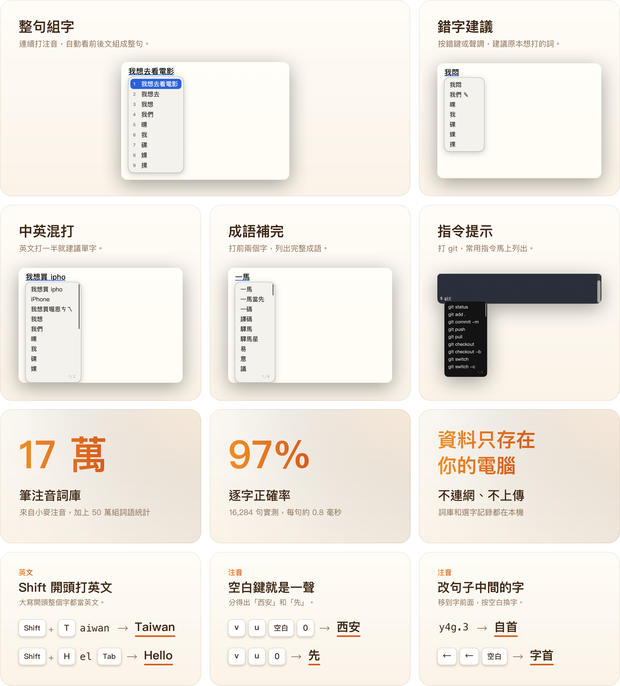

<p align="center">
  
</p>

<p align="center">
  <b>狗哥智慧輸入法</b>是 macOS 的注音輸入法。連續打注音就自動組成整句，中文裡直接夾打英文不用切換，英文單字、成語和 git 等指令打一半就有建議。詞庫、選字記錄和你打的字都只留在你的 Mac，不會上傳。
</p>

<p align="center">
  <a href="https://github.com/qso71/gouge-smart-input-releases/releases/latest"></a>
</p>

<p align="center"><sub>macOS 11 以上　·　繁體中文注音　·　資料只存在你的電腦</sub></p>

<br>

<h2 align="center">打字，本來就該這麼順。</h2>
<p align="center">整句組字、中英混打、成語與指令補完，一個輸入法全包。</p>

<p align="center">
  
</p>

<br>

## 安裝

<p align="center">
  
</p>

1. 下載 [最新版本](https://github.com/qso71/gouge-smart-input-releases/releases/latest) 的 `GougeSmartInput-版本號.dmg`，打開後雙擊「安裝狗哥智慧輸入法」。
2. 裝好後選你會用狗哥做什麼（寫程式、文書、打遊戲、聊天），狗哥會幫你調好設定。
3. 沒看到狗哥的話，到「系統設定 → 鍵盤 → 文字輸入 → 編輯…」按「＋」加入。

也可以用 [Homebrew](https://brew.sh) 安裝，之後用 `brew upgrade` 更新：

```sh
brew tap qso71/gouge https://github.com/qso71/gouge-smart-input-releases
brew trust qso71/gouge
brew install --cask gouge-smart-input
```

> [!NOTE]
> 安裝檔尚未經過 Apple 公證，第一次打開被擋下時，到「系統設定 → 隱私權與安全性」允許打開。安裝前可以先展開下方的「核對檔案」，確認檔案沒有被改過。

## 插件包

替狗哥加上更多指令提示。**1.0.3 起，下面這些都已內建**，到「我的詞庫… → 指令庫」打開就能用；舊版可以下載後按「匯入指令包…」匯入。插件包只有文字，不含程式碼。

| 分類 | 指令包 |
|---|---|
| Python | [python](packs/python.txt)　[conda](packs/conda.txt)　[pyenv](packs/pyenv.txt) |
| App 開發 | [xcode](packs/xcode.txt)　[gradle](packs/gradle.txt)　[dotnet](packs/dotnet.txt)　[rustup](packs/rustup.txt) |
| 雲端與部署 | [vercel](packs/vercel.txt)　[firebase](packs/firebase.txt)　[supabase](packs/supabase.txt) |
| 伺服器 | [ssh](packs/ssh.txt)　[tmux](packs/tmux.txt)　[systemd](packs/systemd.txt) |
| 工具 | [ffmpeg](packs/ffmpeg.txt)　[openssl](packs/openssl.txt)　[ollama](packs/ollama.txt) |

每個包的內容和投稿方式在 [packs](packs) 資料夾。

<br>

<details>
<summary><b>選字為什麼準</b></summary>
<br>

- **完整的注音詞庫**：172,138 筆詞彙，來自開源的 [小麥注音](https://github.com/openvanilla/McBopomofo)（MIT 授權）。
- **看前後文挑同音字**：使用 Hugging Face 為訓練大型語言模型整理的 [FineWeb-2](https://huggingface.co/datasets/HuggingFaceFW/fineweb-2) 網頁語料，從約 7.2 萬篇台灣網頁統計出 50 萬組「哪個詞後面常接哪個詞」，分得出「想做的事」和「想做的是」。
- **實際測過**：用 16,284 句 MozTW 公開句子測試，整句完全正確 82.6%、逐字正確 97.0%，每句組字不到 1 毫秒。
- **全部在你的電腦上運算**：狗哥不使用 AI 模型，統計資料隨 App 安裝在本機。唯一會連網的是每週一次到 GitHub 檢查新版，不會傳送你打的字，也可以在偏好設定關掉。

</details>

<details>
<summary><b>完整按鍵表</b></summary>
<br>

| 按鍵 | 作用 |
|---|---|
| `空白` | 一聲；再按一次打開候選字 |
| `↓` | 打開候選字 |
| `←` `→` | 移到某個字前面，再按空白可以換字 |
| `Return` | 送出 |
| `Tab` | 接受英文或成語建議 |
| 單按 `Shift` | 切換中文與純英文，游標旁顯示 ㄅ 或 A |
| `Shift` + 字母 | 開始一個英文單字，例如 Taiwan |
| `Shift` + `←` `→` | 圈選兩個字以上，按 Return 加入詞庫 |
| `~` 連按兩次 | 打開符號清單 |
| 連按兩次 `Control` | 用「字典」查選取的文字 |

完整說明在輸入法選單的「使用手冊」，每個功能都附試打框。

</details>

<details>
<summary><b>核對檔案</b></summary>
<br>

打開「終端機」輸入下面的指令，把顯示的值和該版 Release 附的 `SHA256SUMS.txt` 逐字比對，完全相同才安裝。

```sh
shasum -a 256 ~/Downloads/GougeSmartInput-*.dmg
```

</details>

<details>
<summary><b>解除安裝</b></summary>
<br>

1. 到「系統設定 → 鍵盤 → 文字輸入 → 編輯…」，選狗哥智慧輸入法，按「−」移除。
2. 從 `/Library/Input Methods` 移除「狗哥智慧輸入法.app」，macOS 會要求管理員密碼。

照這個順序就不用登出。用 Homebrew 安裝的話，執行 `brew uninstall --cask gouge-smart-input`，再做第 1 步。

</details>

<br>

---

<p align="center">
  <sub><a href="https://github.com/qso71/gouge-smart-input-releases/releases">更新內容</a>　·　<a href="https://github.com/qso71/gouge-smart-input-releases/issues/new/choose">回報問題</a>　·　<a href="LICENSE.md">使用條款</a>　·　<a href="mailto:qso713425@gmail.com?subject=%E7%8B%97%E5%93%A5%E6%99%BA%E6%85%A7%E8%BC%B8%E5%85%A5%E6%B3%95">聯絡我</a></sub><br>
  <sub>注音詞庫衍生自 <a href="https://github.com/openvanilla/McBopomofo">OpenVanilla McBopomofo</a>（MIT 授權）；詞組接續統計取自 FineWeb-2 的台灣網頁（ODC-By 1.0）。完整授權聲明附在安裝檔的 THIRD_PARTY_NOTICES.md。</sub>
</p>
