<p align="center">
  <picture><source media="(prefers-color-scheme: dark)" srcset="images/dark/banner.png"></picture>
</p>

<p align="center">
  <a href="https://github.com/qso71/gouge-smart-input-releases/releases/latest"><picture><source media="(prefers-color-scheme: dark)" srcset="images/dark/button.png"></picture></a>
</p>

<p align="center">
  <sub>macOS 11 以上　·　繁體中文注音　·　資料只存在你的電腦</sub>
</p>

<br>

## 功能

<p align="center">
  <picture><source media="(prefers-color-scheme: dark)" srcset="images/dark/sentence.png">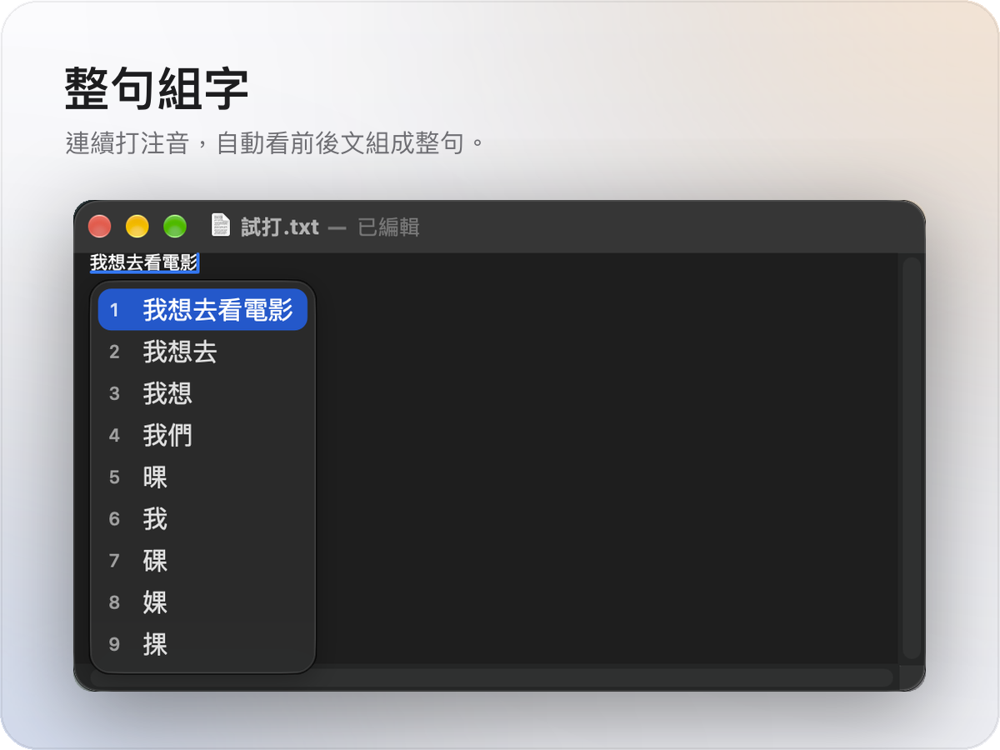</picture>
  <picture><source media="(prefers-color-scheme: dark)" srcset="images/dark/english.png">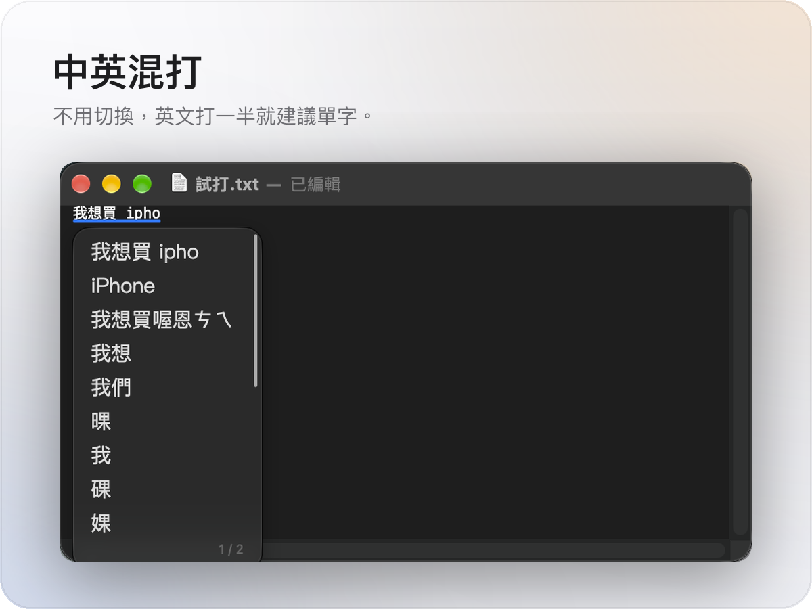</picture>
</p>
<p align="center">
  <picture><source media="(prefers-color-scheme: dark)" srcset="images/dark/idiom.png">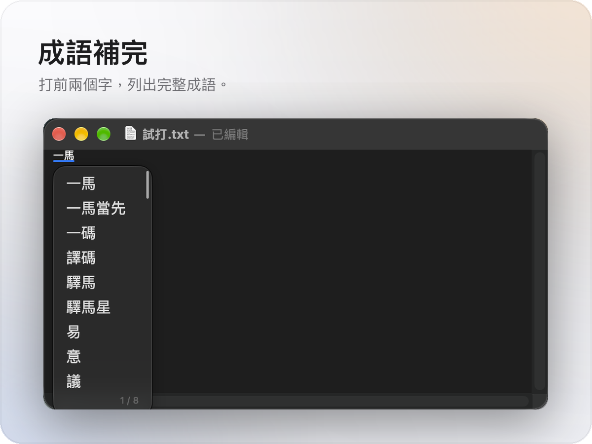</picture>
  <picture><source media="(prefers-color-scheme: dark)" srcset="images/dark/command.png">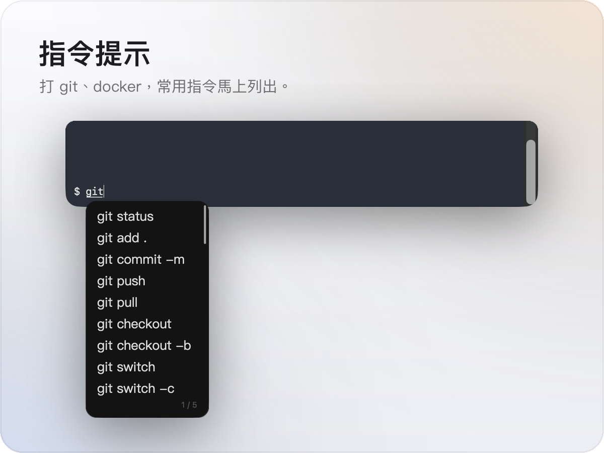</picture>
</p>
<p align="center">
  <picture><source media="(prefers-color-scheme: dark)" srcset="images/dark/typo.png"></picture>
  <picture><source media="(prefers-color-scheme: dark)" srcset="images/dark/vocabulary.png"></picture>
</p>

<br>

## 還有這些細節

<p align="center">
  <picture><source media="(prefers-color-scheme: dark)" srcset="images/dark/more-tone.png">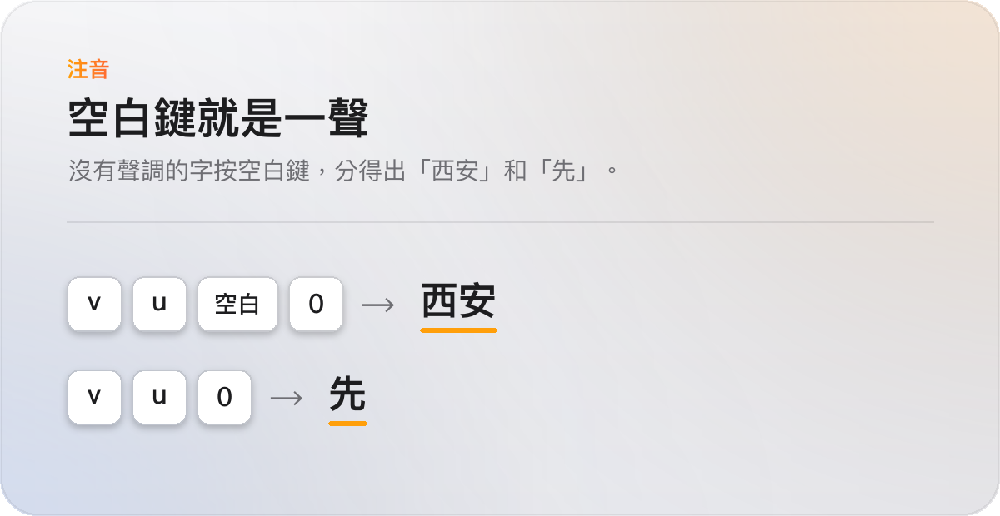</picture>
  <picture><source media="(prefers-color-scheme: dark)" srcset="images/dark/more-fix.png">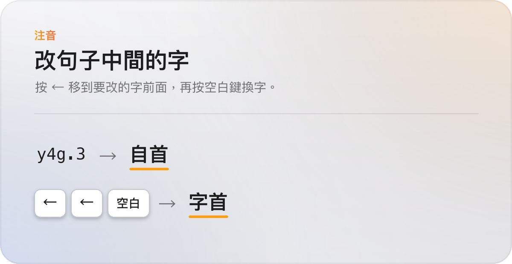</picture>
</p>
<p align="center">
  <picture><source media="(prefers-color-scheme: dark)" srcset="images/dark/more-capital.png">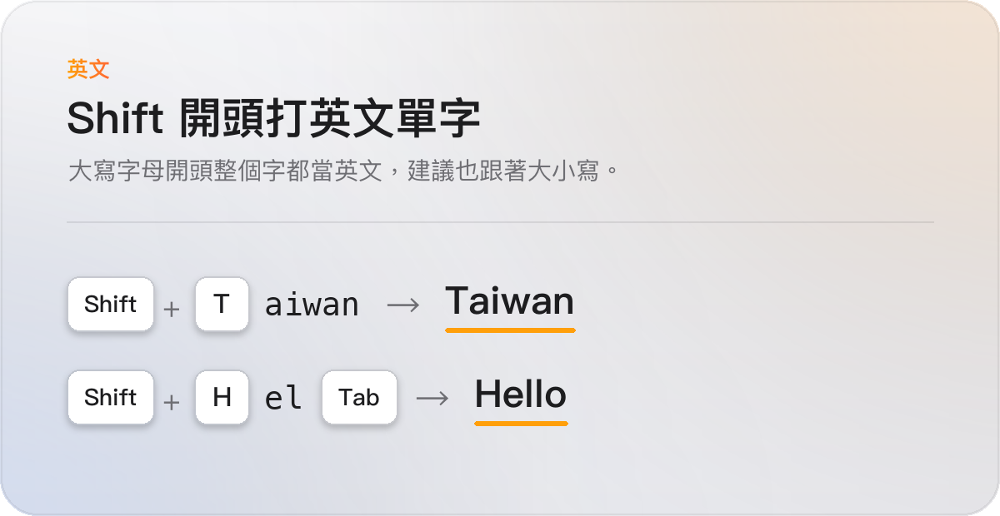</picture>
  <picture><source media="(prefers-color-scheme: dark)" srcset="images/dark/more-spelling.png">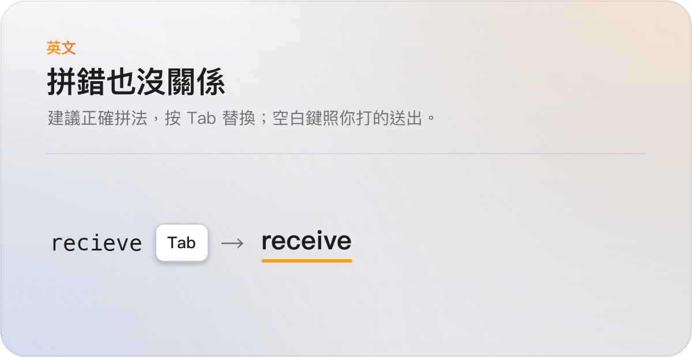</picture>
</p>
<p align="center">
  <picture><source media="(prefers-color-scheme: dark)" srcset="images/dark/more-phrases.png">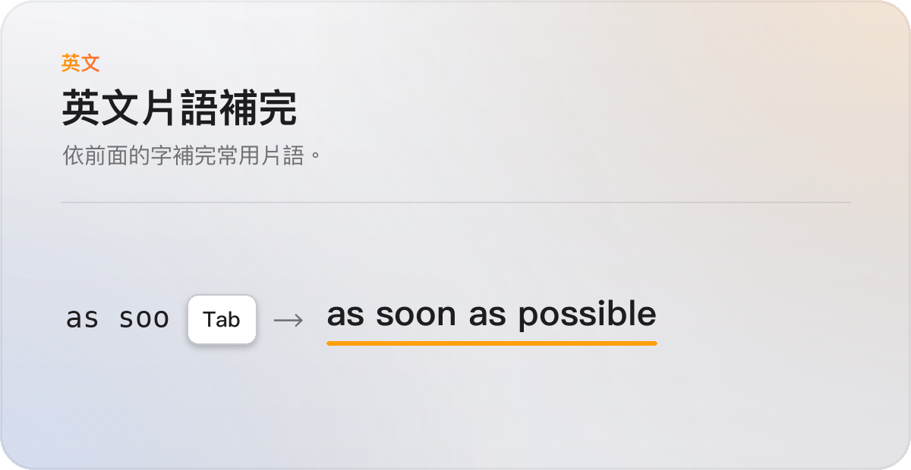</picture>
  <picture><source media="(prefers-color-scheme: dark)" srcset="images/dark/more-address.png">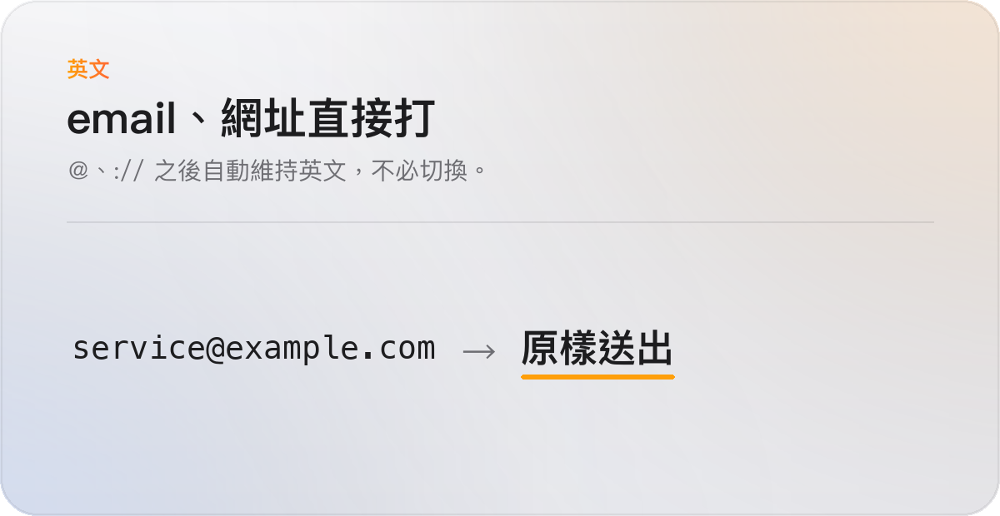</picture>
</p>
<p align="center">
  <picture><source media="(prefers-color-scheme: dark)" srcset="images/dark/more-numbers.png">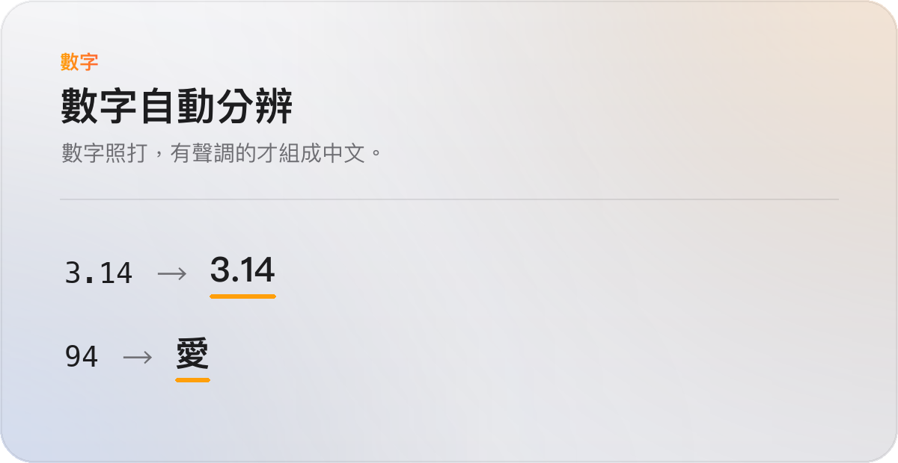</picture>
  <picture><source media="(prefers-color-scheme: dark)" srcset="images/dark/more-punctuation.png">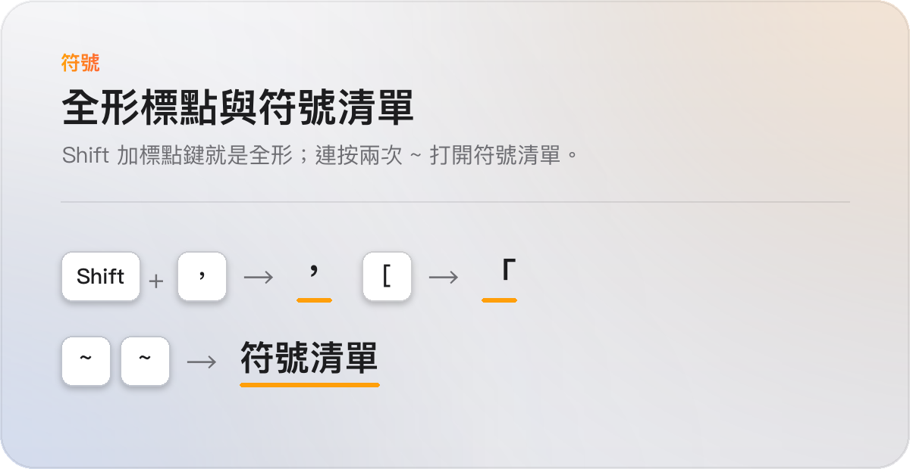</picture>
</p>
<p align="center">
  <picture><source media="(prefers-color-scheme: dark)" srcset="images/dark/more-add-phrase.png">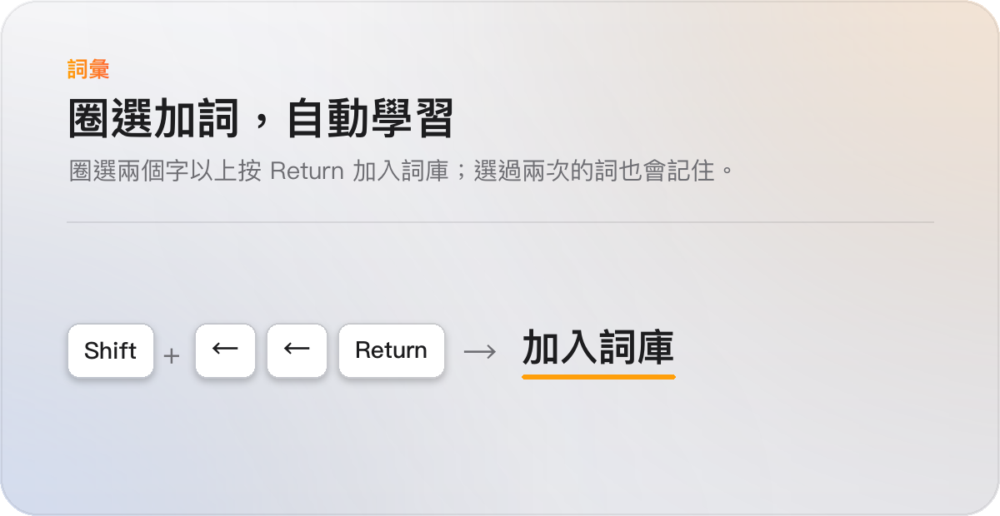</picture>
  <picture><source media="(prefers-color-scheme: dark)" srcset="images/dark/more-dictionary.png">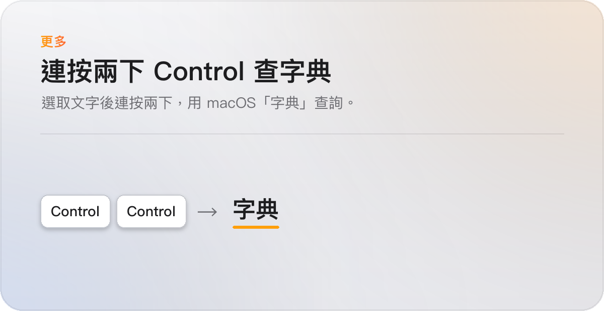</picture>
</p>

<br>

## 選字為什麼準

<p align="center">
  <picture><source media="(prefers-color-scheme: dark)" srcset="images/dark/stats.png">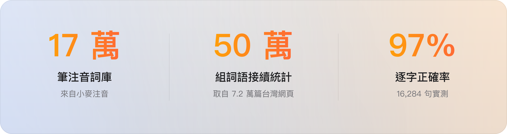</picture>
</p>

- **完整的注音詞庫**：172,138 筆詞彙，來自開源的 [小麥注音](https://github.com/openvanilla/McBopomofo)（MIT 授權）。
- **看前後文挑同音字**：使用 Hugging Face 為訓練大型語言模型整理的 [FineWeb-2](https://huggingface.co/datasets/HuggingFaceFW/fineweb-2) 網頁語料，從約 7.2 萬篇台灣網頁統計出 50 萬組「哪個詞後面常接哪個詞」，分得出「想做的事」和「想做的是」。
- **實際測過**：用 16,284 句 MozTW 公開句子測試，整句完全正確 82.6%、逐字正確 97.0%，每句組字不到 1 毫秒。
- **全部在你的電腦上運算**：狗哥不使用 AI 模型、也不連網，統計資料隨 App 安裝在本機。

<br>

## 常用按鍵

<details>
<summary><b>完整按鍵表</b></summary>
<br>

| 按鍵 | 作用 |
|---|---|
| `空白` | 一聲；再按一次打開候選字 |
| `↓` | 打開候選字 |
| `←` `→` | 移到某個字前面，再按空白可以換字 |
| `Return` | 送出 |
| `Tab` | 接受英文或成語建議 |
| 單按 `Shift` | 切換中文與純英文，游標旁顯示 ㄅ 或 A |
| `Shift` + 字母 | 開始一個英文單字，例如 Taiwan |
| `Shift` + `←` `→` | 圈選兩個字以上，按 Return 加入詞庫 |
| `~` 連按兩次 | 打開符號清單 |
| 連按兩次 `Control` | 用「字典」查選取的文字 |

完整說明在輸入法選單的「使用手冊」，每個功能都附試打框。

</details>

<br>

## 安裝

1. 到 [Releases](https://github.com/qso71/gouge-smart-input-releases/releases/latest) 下載 `GougeSmartInput-版本號.dmg`。
2. 打開 DMG，雙擊「安裝狗哥智慧輸入法」，依畫面指示完成安裝。
3. 裝好後選你會用狗哥做什麼：寫程式、文書、打遊戲、聊天，可以複選。之後也能在「偏好設定」更改。
4. 如果輸入法沒有出現，到「系統設定 → 鍵盤 → 文字輸入 → 編輯…」，按「＋」→ 繁體中文 → 狗哥智慧輸入法 → 加入。還是找不到的話，登出再登入一次。

<p align="center">
  <picture><source media="(prefers-color-scheme: dark)" srcset="images/dark/install-welcome.png">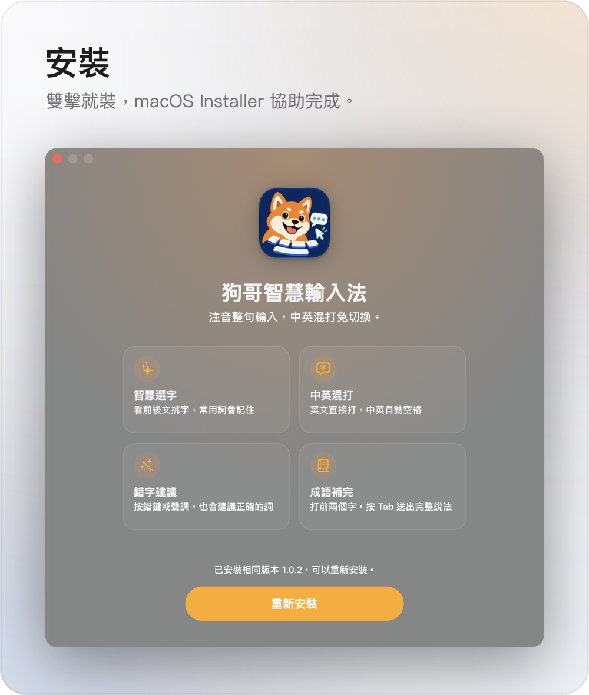</picture>
  <picture><source media="(prefers-color-scheme: dark)" srcset="images/dark/install-profiles.png"></picture>
</p>

> [!IMPORTANT]
> 安裝檔尚未使用 Developer ID 簽署及 Apple 公證。安裝前請先核對檔案沒有被改過：打開「終端機」輸入
>
> ```sh
> shasum -a 256 ~/Downloads/GougeSmartInput-*.dmg
> ```
>
> 把顯示的值和該版 Release 附的 `SHA256SUMS.txt` 逐字比對，完全相同才安裝。第一次打開被 macOS 擋下時，到「系統設定 → 隱私權與安全性」允許打開。

<details>
<summary><b>解除安裝</b></summary>
<br>

從 `/Library/Input Methods` 移除「狗哥智慧輸入法.app」，然後登出再登入。macOS 會要求管理員密碼。

</details>

<br>

## 更新內容

每一版的更新內容寫在 [Releases](https://github.com/qso71/gouge-smart-input-releases/releases) 的說明裡。

<br>

---

<p align="center">
  <sub>注音詞庫衍生自 <a href="https://github.com/openvanilla/McBopomofo">OpenVanilla McBopomofo</a>（MIT 授權）；詞組接續統計取自 FineWeb-2 的台灣網頁（ODC-By 1.0）。<br>完整授權聲明附在安裝檔的 THIRD_PARTY_NOTICES.md。</sub>
</p>
