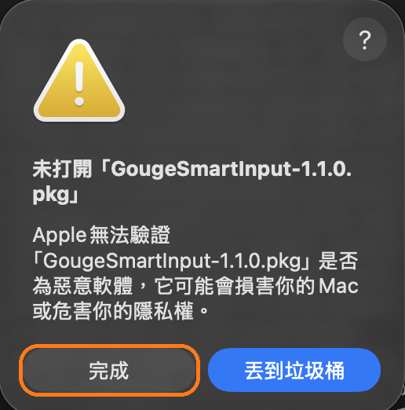
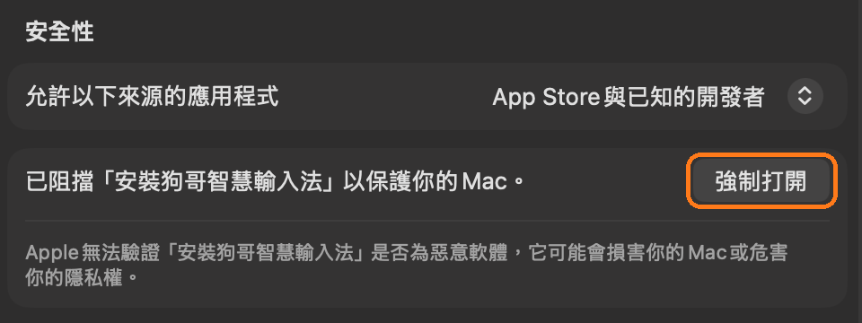
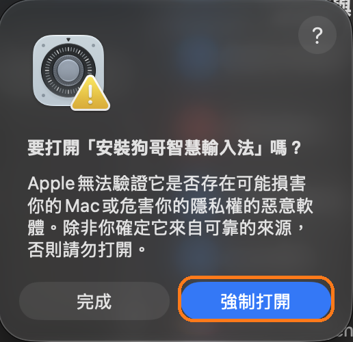
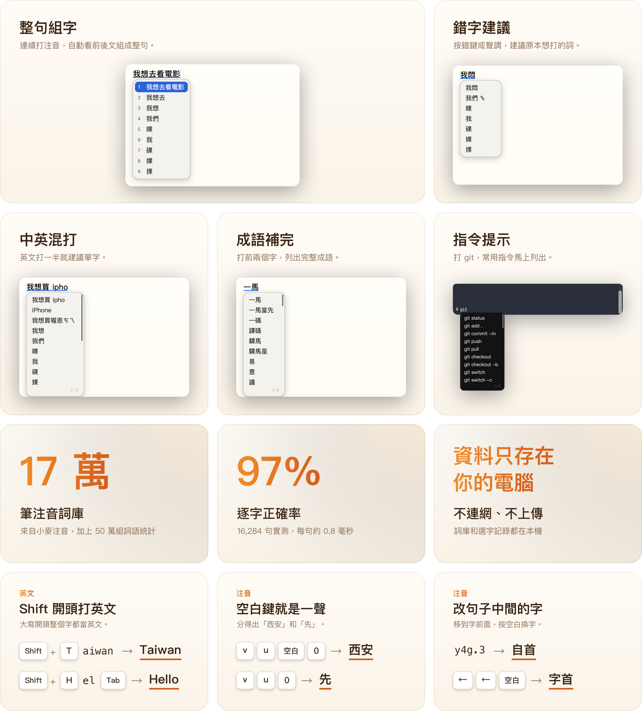

<p align="center">
  <a href="https://github.com/qso71/gouge-smart-input-releases/releases/latest"></a>
</p>

<h3 align="center">打字，本來就該這麼順。</h3>

<p align="center">
  <a href="https://github.com/qso71/gouge-smart-input-releases/releases/latest"></a>
  <a href="https://github.com/qso71/gouge-smart-input-releases/releases"></a>
  
  
  
</p>

<p align="center">
  <a href="https://github.com/qso71/gouge-smart-input-releases/releases/latest/download/GougeSmartInput.dmg"><b>下載</b></a>　·
  <a href="https://qso71.github.io/gouge-smart-input-releases/"><b>官網</b></a>　·
  <a href="#quick-start"><b>安裝</b></a>　·
  <a href="https://github.com/qso71/gouge-smart-input-releases/releases"><b>更新內容</b></a>　·
  <a href="https://github.com/qso71/gouge-smart-input-releases/issues/new/choose"><b>回報問題</b></a>
</p>

<p align="center">
  <a href="https://github.com/qso71/gouge-smart-input-releases/releases/latest/download/GougeSmartInput.dmg"></a>
</p>

<p align="center"><sub>想收新版通知？<a href="https://qso71.github.io/gouge-smart-input-releases/#newsletter">留個 email</a>（選填），或在這個 repo 按 Watch → Custom → Releases。</sub></p>

**狗哥智慧輸入法是 macOS 的注音輸入法，整句組字在你的 Mac 上算好，打的字不上傳。**

一般注音輸入法要一個字一個字選，打英文得切換，指令和成語要自己記。狗哥連續打注音就組好整句，中文裡直接夾英文，英文單字、成語和 git 等指令打一半就有建議。組字不靠雲端，也不靠大型語言模型：每句約 1 毫秒，整個 App 約 40 MB，Intel 和 Apple Silicon 都能用。

> [!IMPORTANT]
> **1.7.0 來了**：打「今天」直接出日期，打 =12*30+5 直接算出 365，句子中間也能選 Emoji。
> [看完整更新內容 →](https://github.com/qso71/gouge-smart-input-releases/releases/latest)

<a id="quick-start"></a>
<a id="install"></a>

## 快速開始

**1. 下載。** 按上面的「下載」，會下載最新版的 `GougeSmartInput.dmg`。

**2. 安裝。** 打開後雙擊「安裝狗哥智慧輸入法」，照畫面按下一步，最後選你的用途（寫程式、文書、打遊戲、聊天），狗哥會調好設定。第一次會被 macOS 擋下，照[下面 3 步](#first-open)打開，只要做一次。

**3. 試打。** 切到狗哥，打 ㄍㄡˇㄍㄜ 按 Return。出現「狗哥」就裝好了。

選單裡找不到狗哥的話，到「系統設定 → 鍵盤 → 文字輸入 → 編輯…」按「＋」加入；「＋」裡也找不到，就登出再登入一次。

會用 Homebrew 的話，也可以這樣裝，之後用 `brew upgrade` 更新：

```sh
brew tap qso71/gouge https://github.com/qso71/gouge-smart-input-releases
brew trust qso71/gouge
brew install --cask gouge-smart-input
```

<a id="first-open"></a>

### 第一次打開被 macOS 擋下

macOS 會說「Apple 無法驗證……是否為惡意軟體」。狗哥是個人開發的免費軟體，沒有付費請 Apple 公證，macOS 對所有沒公證的軟體都會這樣，不是在檔案裡找到病毒。

1. 跳出「未打開」時按「**完成**」。直接打開 `.pkg` 的話，視窗裡還有一個藍色的「丟到垃圾桶」，**不要按它**，它會刪掉下載的檔案。

   

2. 打開「**系統設定 → 隱私權與安全性**」，捲到「安全性」，在「已阻擋……以保護你的 Mac」旁邊按「**強制打開**」。

   

3. 跳出「要打開……嗎？」時按藍色的「**強制打開**」，再用 Touch ID 或密碼確認，安裝畫面就會打開。

   

<details>
<summary>會用「終端機」的話</summary>
<br>

打開下載的檔案前先執行這一行，拿掉 macOS 加在下載檔案上的標記，就不會被擋下：

```sh
xattr -d com.apple.quarantine ~/Downloads/GougeSmartInput*
```

</details>

## 功能

整句組字、中英混打、成語與指令補完，一個輸入法全包。每個功能在輸入法選單的「狗哥手冊」裡都有說明和試打框。

| 功能 | 做什麼 | 試試看 |
|---|---|---|
| **整句組字** | 連續打注音，整句一起組好 | 打 ㄨㄛˇㄒㄧㄤˇㄑㄩˋㄎㄢˋㄉㄧㄢˋㄧㄥˇ，得到「我想去看電影」 |
| **改句子中間的字** | 用 ← → 移到字前面按空白換字 | 把「自首」改成「字首」 |
| **錯字建議** | 按錯旁邊的鍵或聲調、ㄣㄥ 不分，建議修好的詞 | 打成「我悶」，按 Tab 換成「我們」 |
| **中英混打** | 中文裡直接打英文，不用切換 | 打「我想買 ipho」，建議 iPhone |
| **成語與單字補完** | 打一半就建議整個詞 | 打「一馬」，列出「一馬當先」 |
| **指令提示** | 終端機裡提示指令和參數，還能幫你寫 commit | 終端機打 git |
| **日期和算數** | 日期詞換成日期，= 開頭直接算 | 打「今天」；打 =12*30+5 |
| **Emoji** | 詞後面接著就是它的 Emoji | 打「開心」，候選字有 😊 |
| **記住你的習慣** | 選過兩次的詞，下次排第一 | 同一個詞改選兩次 |
| **我的詞庫** | 加詞、隱藏詞、匯入匯出、文字範本 | Shift + ← → 圈選兩個字以上，按 Return |
| **iCloud 同步** | 兩台 Mac 共用詞庫，放在你自己的 iCloud | 偏好設定「進階」打開 |
| **選單列小狗** | 打字時在選單列陪你跑，太久沒打就睡著 | 偏好設定「一般」最上面打開 |



35 秒看完整句組字、中英混打、成語補完和寫程式，開聲音看更清楚：

https://github.com/user-attachments/assets/9594d17d-38be-4436-8ae2-3585359e0b84

## 狗哥小幫手

改一件小事，不用再開 ChatGPT、貼一大段、來回對話。連按兩次 Option 叫出問狗哥，選取的那段可以改寫、解釋詞或寫程式，改好直接換掉原文。

| 服務 | 說明 |
|---|---|
| OpenAI、Claude | 填你自己的 API key，每個服務各自記住網址、模型和 key |
| Ollama | 用你 Mac 上跑的模型，不花 token |

預設關閉，到偏好設定「狗哥小幫手」打開。只有你按下送出，才會把視窗裡的文字送到你選的服務。

https://github.com/user-attachments/assets/250bb3ed-0549-4121-9320-6ba304555d81

## 和其他輸入法比較

很多接 AI 的輸入法把你打的字送到雲端，用大型語言模型組字。狗哥刻意不這樣做。

| | 狗哥 | 其他接 AI 的輸入法 |
|---|---|---|
| 你打的字 | 不上傳 | 送到雲端伺服器 |
| 每句組字 | 約 1 毫秒 | 幾十毫秒以上 |
| 要多裝 | 約 40 MB | 400 MB 以上 |
| 哪些 Mac 能用 | macOS 13 以上，Intel 和 Apple Silicon | 要 Apple Silicon，或一直連網 |

## 怎麼組字

選字靠 22 萬筆注音詞庫（[小麥注音](https://github.com/openvanilla/McBopomofo)）和 [FineWeb-2](https://huggingface.co/datasets/HuggingFaceFW/fineweb-2) 台灣網頁統計的詞組搭配，再加上你自己選過的詞，以及游標前後文裡出現過的詞。在 16,272 句上實測，整句正確 86.2%。

我們也試過讓 1 億參數的語言模型挑字：只多對 2.4% 的句子，卻慢 60 倍，所以沒有採用。

## 隱私

- **打的字不上傳。** 組字、選字記錄和詞庫都只在你的 Mac 上。
- **會連網的只有兩件事**：每週檢查一次更新（可以關掉），以及你打開狗哥小幫手後、自己按下送出的那段文字。
- **iCloud 同步要自己打開**，詞庫放在你自己的 iCloud。
- **當機回報**會先給你看內容，你決定送不送。

## 按鍵

| 按鍵 | 作用 |
|---|---|
| `空白` | 一聲；再按一次打開候選字 |
| `↓` | 打開候選字 |
| `←` `→` | 移到某個字前面，再按空白可以換字 |
| `Return` | 送出；最後一個字沒打聲調時，送出注音本身 |
| `Tab` | 接受英文或成語建議 |
| 單按 `Shift` | 切換中文與純英文，游標旁顯示 ㄅ 或 A |
| `Shift` + 字母 | 開始一個英文單字，例如 Taiwan |
| `Shift` + `←` `→` | 圈選兩個字以上，按 Return 加入詞庫 |
| `~` 連按兩次 | 打開符號清單；再按空白是文字範本 |
| 連按兩次 `Control` | 用「字典」查選取的文字 |
| 連按兩次 `Option` | 叫出問狗哥（要先打開狗哥小幫手） |
| `⌘3`～`⌘7`、`⌘2`、`⌘E` | 在問狗哥裡：改寫、解釋詞、寫程式 |

## 插件包

替狗哥加上更多指令提示。插件包只有文字，不含程式碼。下載後到「我的詞庫… → 指令庫」按「匯入指令包…」。

| 分類 | 指令包 |
|---|---|
| 壓縮 | [archive](packs/archive.txt)：`tar` `unzip` `gzip` |
| 網路與傳檔 | [network](packs/network.txt)：`curl` `wget` `scp` `lsof` |
| 文字處理 | [text](packs/text.txt)：`grep` `sed` `awk` `xargs` |
| 檔案 | [files](packs/files.txt)：`chmod` `chown` `mkdir` `du` `df` |
| macOS | [macos](packs/macos.txt)：`pbcopy` `xattr` `codesign` `launchctl` |

這些已經內建，到「我的詞庫… → 指令庫」打開就能用：

| 分類 | 指令包 |
|---|---|
| Python | [python](packs/python.txt)　[conda](packs/conda.txt)　[pyenv](packs/pyenv.txt) |
| App 開發 | [xcode](packs/xcode.txt)　[gradle](packs/gradle.txt)　[dotnet](packs/dotnet.txt)　[rustup](packs/rustup.txt) |
| 雲端與部署 | [vercel](packs/vercel.txt)　[firebase](packs/firebase.txt)　[supabase](packs/supabase.txt) |
| 伺服器 | [ssh](packs/ssh.txt)　[tmux](packs/tmux.txt)　[systemd](packs/systemd.txt) |
| 工具 | [ffmpeg](packs/ffmpeg.txt)　[openssl](packs/openssl.txt)　[ollama](packs/ollama.txt) |

每個包的內容和投稿方式在 [packs](packs) 資料夾。

## 常見問題

<details>
<summary><b>要錢嗎？</b></summary>
<br>

免費，個人或工作用途都可以，裝幾台 Mac 都沒有限制。詳見[使用條款](LICENSE.md)。

</details>

<details>
<summary><b>可以和內建的注音一起用嗎？</b></summary>
<br>

可以。狗哥是另一個輸入法，和內建注音都留在「文字輸入」清單裡，隨時切換。

</details>

<details>
<summary><b>怎麼更新？</b></summary>
<br>

狗哥每週檢查一次新版，有新版時按「立即更新」，輸入密碼就裝好。不想收到通知，到偏好設定「進階」關掉「自動檢查更新」。用 Homebrew 安裝的話，執行 `brew upgrade`。

</details>

<details>
<summary><b>怎麼核對下載的檔案？</b></summary>
<br>

打開「終端機」輸入下面的指令，把顯示的值和該版 Release 附的 `SHA256SUMS.txt` 逐字比對，完全相同才安裝。

```sh
shasum -a 256 ~/Downloads/GougeSmartInput*.dmg
```

</details>

<details>
<summary><b>怎麼退回舊版？</b></summary>
<br>

1. 到[所有版本](https://github.com/qso71/gouge-smart-input-releases/releases)找到想要的版本，下載 `GougeSmartInput-版本號.pkg`，打開直接安裝，會蓋掉目前的版本。
2. 不想一直收到新版通知的話，到「偏好設定 → 進階」關掉「自動檢查更新」。

1.0.5 起，每次自動更新前會先備份詞庫和選字記錄，保留最近 3 份，放在 `~/Library/Application Support/QingyuZhuyin/Backups`。退回舊版後如果詞庫怪怪的，把檔名是那個版本的備份，例如 `user-library-1.0.5.json`，複製回上一層資料夾並改名成 `user-library.json` 蓋掉原本的檔案，再切換一次輸入法。

</details>

<details>
<summary><b>怎麼解除安裝？</b></summary>
<br>

1. 到「系統設定 → 鍵盤 → 文字輸入 → 編輯…」，選狗哥智慧輸入法，按「−」移除。
2. 從 `/Library/Input Methods` 移除「狗哥智慧輸入法.app」，macOS 會要求管理員密碼。

照這個順序就不用登出。用 Homebrew 安裝的話，執行 `brew uninstall --cask gouge-smart-input`，再做第 1 步。

</details>

<details>
<summary><b>有 Linux 版嗎？</b></summary>
<br>

有預覽版，目前只支援 Ubuntu 24.04 ARM64，見[下載和安裝說明](https://github.com/qso71/gouge-smart-input-releases/releases/tag/linux-preview-1)。

</details>

## 回報問題

打錯字、當掉或想要新功能，到 [Issues](https://github.com/qso71/gouge-smart-input-releases/issues/new/choose) 告訴我。寫下你打的注音、在哪個 App、出現了什麼，最好修。其他事可以[寫信給我](mailto:qso713425@gmail.com?subject=%E7%8B%97%E5%93%A5%E6%99%BA%E6%85%A7%E8%BC%B8%E5%85%A5%E6%B3%95)。

## 參與

常用的指令狗哥還不會提示的話，可以投稿[插件包](packs)，只要一個文字檔。

## 使用條款與來源

狗哥免費使用，條款見[使用條款](LICENSE.md)（[English](LICENSE.en.md)）。注音詞庫衍生自 [OpenVanilla McBopomofo](https://github.com/openvanilla/McBopomofo)（MIT 授權），詞組接續統計取自 FineWeb-2 的台灣網頁（ODC-By 1.0），完整授權聲明附在安裝檔的 THIRD_PARTY_NOTICES.md。
