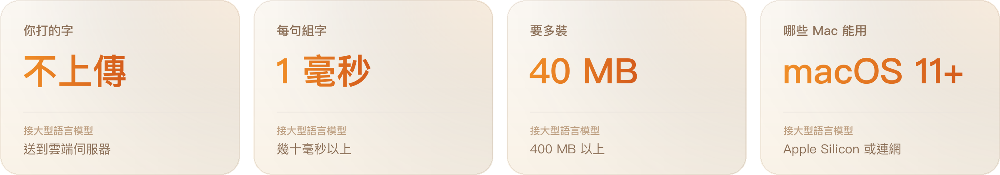

<p align="center">
  
</p>

<p align="center">
  <b>狗哥智慧輸入法</b>是 macOS 的注音輸入法。連續打注音就自動組成整句，中文裡直接夾打英文不用切換，英文單字、成語和 git 等指令打一半就有建議。詞庫、選字記錄和你打的字都只留在你的 Mac，不會上傳。
</p>

<p align="center">
  <a href="https://github.com/qso71/gouge-smart-input-releases/releases/latest"></a>
</p>

<p align="center">
  <a href="https://github.com/qso71/gouge-smart-input-releases/releases/latest"></a>
  <a href="https://github.com/qso71/gouge-smart-input-releases/releases"></a>
  
  
</p>

<br>

<h2 align="center">打字，本來就該這麼順。</h2>
<p align="center">整句組字、中英混打、成語與指令補完，一個輸入法全包。</p>

<p align="center">
  
</p>

<h2 align="center">不靠 AI，也打得準。</h2>
<p align="center">很多輸入法開始接大型語言模型，狗哥刻意不這樣做。</p>

<p align="center">
  
</p>

<p align="center"><sub>選字靠 22 萬筆注音詞庫（<a href="https://github.com/openvanilla/McBopomofo">小麥注音</a>）和 <a href="https://huggingface.co/datasets/HuggingFaceFW/fineweb-2">FineWeb-2</a> 網頁統計的詞組搭配，16,272 句實測整句正確 86.2%。<br>我們也試過讓 1 億參數的語言模型挑字：只多對 2.4% 的句子，卻慢 60 倍。</sub></p>

<br>

<h2 align="center">還有這些。</h2>
<p align="center">從寫程式到查字典，常用的小事都幫你想好了。</p>

<p align="center">
  
</p>

<br>

## 安裝

<table>
<tr>
<td width="50%"></td>
<td>

**1　下載**<br>
到 [最新版本](https://github.com/qso71/gouge-smart-input-releases/releases/latest) 下載 `GougeSmartInput-版本號.dmg`。

**2　安裝**<br>
打開後雙擊「安裝狗哥智慧輸入法」，照畫面按下一步。

**3　選用途**<br>
選你會用狗哥做什麼：寫程式、文書、打遊戲、聊天，狗哥幫你調好設定。

**沒看到狗哥？**<br>
到「系統設定 → 鍵盤 → 文字輸入 → 編輯…」按「＋」加入。

</td>
</tr>
</table>

也可以用 [Homebrew](https://brew.sh) 安裝，之後用 `brew upgrade` 更新：

```sh
brew tap qso71/gouge https://github.com/qso71/gouge-smart-input-releases
brew trust qso71/gouge
brew install --cask gouge-smart-input
```

> [!NOTE]
> 安裝檔尚未經過 Apple 公證，第一次打開被擋下時，到「系統設定 → 隱私權與安全性」允許打開。安裝前可以先展開下方的「核對檔案」，確認檔案沒有被改過。

## 插件包

替狗哥加上更多指令提示。插件包只有文字，不含程式碼。

**下載匯入**：下載後到「我的詞庫… → 指令庫」按「匯入指令包…」。

| 分類 | 指令包 |
|---|---|
| 壓縮 | [archive](packs/archive.txt)：`tar` `unzip` `gzip` |
| 網路與傳檔 | [network](packs/network.txt)：`curl` `wget` `scp` `lsof` |
| 文字處理 | [text](packs/text.txt)：`grep` `sed` `awk` `xargs` |
| 檔案 | [files](packs/files.txt)：`chmod` `chown` `mkdir` `du` `df` |
| macOS | [macos](packs/macos.txt)：`pbcopy` `xattr` `codesign` `launchctl` |

**已內建**（1.0.3 起）：到「我的詞庫… → 指令庫」打開就能用；舊版一樣可以下載匯入。

| 分類 | 指令包 |
|---|---|
| Python | [python](packs/python.txt)　[conda](packs/conda.txt)　[pyenv](packs/pyenv.txt) |
| App 開發 | [xcode](packs/xcode.txt)　[gradle](packs/gradle.txt)　[dotnet](packs/dotnet.txt)　[rustup](packs/rustup.txt) |
| 雲端與部署 | [vercel](packs/vercel.txt)　[firebase](packs/firebase.txt)　[supabase](packs/supabase.txt) |
| 伺服器 | [ssh](packs/ssh.txt)　[tmux](packs/tmux.txt)　[systemd](packs/systemd.txt) |
| 工具 | [ffmpeg](packs/ffmpeg.txt)　[openssl](packs/openssl.txt)　[ollama](packs/ollama.txt) |

每個包的內容和投稿方式在 [packs](packs) 資料夾。

<br>

<details>
<summary><b>完整按鍵表</b></summary>
<br>

| 按鍵 | 作用 |
|---|---|
| `空白` | 一聲；再按一次打開候選字 |
| `↓` | 打開候選字 |
| `←` `→` | 移到某個字前面，再按空白可以換字 |
| `Return` | 送出 |
| `Tab` | 接受英文或成語建議 |
| 單按 `Shift` | 切換中文與純英文，游標旁顯示 ㄅ 或 A |
| `Shift` + 字母 | 開始一個英文單字，例如 Taiwan |
| `Shift` + `←` `→` | 圈選兩個字以上，按 Return 加入詞庫 |
| `~` 連按兩次 | 打開符號清單 |
| 連按兩次 `Control` | 用「字典」查選取的文字 |

完整說明在輸入法選單的「使用手冊」，每個功能都附試打框。

</details>

<details>
<summary><b>核對檔案</b></summary>
<br>

打開「終端機」輸入下面的指令，把顯示的值和該版 Release 附的 `SHA256SUMS.txt` 逐字比對，完全相同才安裝。

```sh
shasum -a 256 ~/Downloads/GougeSmartInput-*.dmg
```

</details>

<details>
<summary><b>退回舊版</b></summary>
<br>

1. 到 [所有版本](https://github.com/qso71/gouge-smart-input-releases/releases) 找到想要的版本，下載 `GougeSmartInput-版本號.pkg`，打開直接安裝，會蓋掉目前的版本。
2. 不想一直收到新版通知的話，到「偏好設定 → 進階」關掉「自動檢查更新」。

1.0.5 起，每次自動更新前會先備份詞庫和選字記錄，保留最近 3 份，放在 `~/Library/Application Support/QingyuZhuyin/Backups`。退回舊版後如果詞庫怪怪的，把檔名是那個版本的備份，例如 `user-library-1.0.5.json`，複製回上一層資料夾並改名成 `user-library.json` 蓋掉原本的檔案，再切換一次輸入法。

</details>

<details>
<summary><b>解除安裝</b></summary>
<br>

1. 到「系統設定 → 鍵盤 → 文字輸入 → 編輯…」，選狗哥智慧輸入法，按「−」移除。
2. 從 `/Library/Input Methods` 移除「狗哥智慧輸入法.app」，macOS 會要求管理員密碼。

照這個順序就不用登出。用 Homebrew 安裝的話，執行 `brew uninstall --cask gouge-smart-input`，再做第 1 步。

</details>

<br>

---

<p align="center">
  <sub><a href="https://github.com/qso71/gouge-smart-input-releases/releases">更新內容</a>　·　<a href="https://github.com/qso71/gouge-smart-input-releases/issues/new/choose">回報問題</a>　·　<a href="LICENSE.md">使用條款</a>（<a href="LICENSE.en.md">English</a>）　·　<a href="mailto:qso713425@gmail.com?subject=%E7%8B%97%E5%93%A5%E6%99%BA%E6%85%A7%E8%BC%B8%E5%85%A5%E6%B3%95">聯絡我</a></sub><br>
  <sub>注音詞庫衍生自 <a href="https://github.com/openvanilla/McBopomofo">OpenVanilla McBopomofo</a>（MIT 授權）；詞組接續統計取自 FineWeb-2 的台灣網頁（ODC-By 1.0）。完整授權聲明附在安裝檔的 THIRD_PARTY_NOTICES.md。</sub>
</p>
